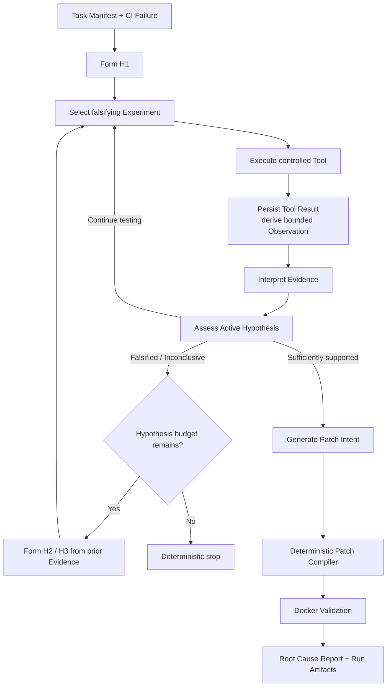
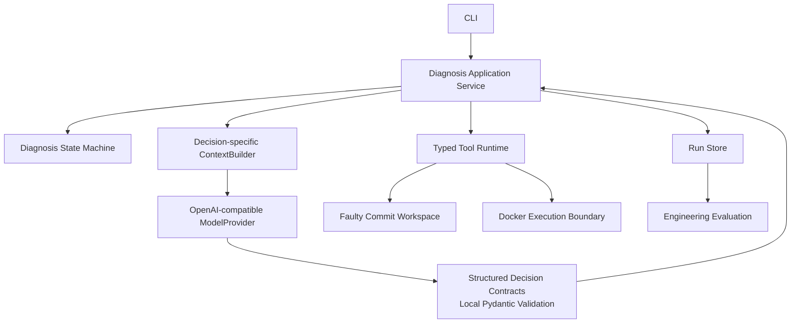
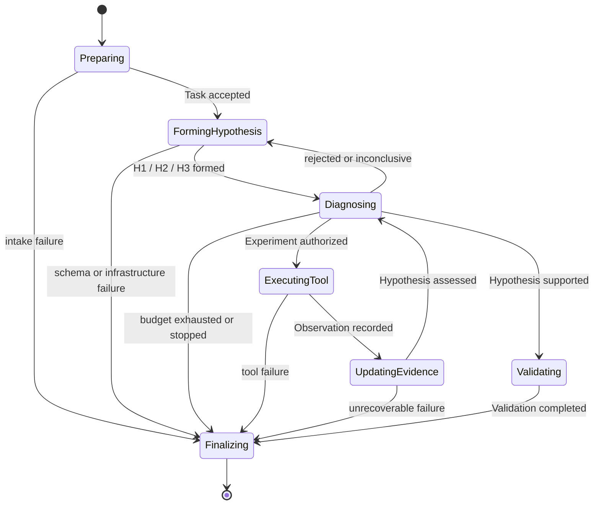

# CodeRCA

CodeRCA 是一个面向单仓库 CI 测试失败的代码根因诊断 Agent。它接收包含 Faulty Commit、CI 日志、注册测试命令和执行边界的 Task Manifest，自主形成并检验诊断假设，定位根因，生成修复方案，并在隔离环境中验证补丁，最终输出根因位置、因果机制、可追溯 Evidence、Candidate Patch、Validation 结果和完整的 Diagnosis Run 审计记录。

CodeRCA 当前聚焦于 Python 项目中由代码变更引起的确定性业务逻辑回归；外部服务故障、性能问题以及随机或并发失败不在当前支持范围内。

## Why CodeRCA

CI 失败诊断不是一次代码生成问题。一个可靠的诊断过程至少需要回答：当前解释如何被证伪、下一次工具调用能提供什么区分性信息、观察结果是否真的支持当前假设、错误方向如何结束，以及修复是否在隔离环境中恢复预期行为。

CodeRCA 因此把 Root Cause Analysis 建模为显式循环，而不是把 CI 日志、Git diff 和整个仓库一次性塞进 Prompt：

```text
Hypothesis → Experiment → Tool → Observation → Evidence → Assessment
      ↑                                                    │
      └──────── Reformulation after rejection ─────────────┘
```

## Diagnosis Workflow

一次 Diagnosis Run 从 Task Manifest 开始。CodeRCA 首先加载 Faulty Commit、CI Failure、注册测试命令和仓库执行边界，并创建独立的 Run Directory。模型根据初始失败信号形成 H1，程序为其分配稳定 ID 并写入结构化 Diagnosis State。

进入诊断循环后，Agent 围绕当前 Active Hypothesis 选择一个具有证伪价值的 Experiment，并调用受控工具检查 Git Diff、搜索或读取代码、运行注册测试。Tool Result 会完整保存为 Run Artifact，同时被转换为有界 Observation；模型再解释该 Observation 与当前 Hypothesis 的关系，形成 Supporting、Contradicting 或 Inconclusive Evidence。

如果现有 Evidence 尚不足，Agent 会为当前 Hypothesis 选择新的 Experiment；如果 Contradicting Evidence 否定了当前机制，程序将其标记为 rejected，并基于已经积累的诊断知识形成 H2 或 H3；如果 Supporting Evidence 已足以解释失败，则将当前 Hypothesis 标记为 supported，进入修复阶段。Hypothesis 或 Tool Budget 耗尽时，Diagnosis Run 按照明确的 Stop Reason 结束。

在修复阶段，模型根据 Supported Hypothesis 提交结构化 Patch Intent，程序将其确定性编译为 Candidate Patch，并在隔离工作区中执行静态检查和注册测试。最后，CodeRCA 输出 Root Cause Report、补丁验证结果以及完整的 Diagnosis Run 审计记录。



## Agent Architecture

### Architecture Overview



- **CLI**：读取 Task Manifest 和 Model Configuration，启动 Diagnosis Run，并输出运行状态、Stop Reason 和 Run Directory。
- **Diagnosis Application Service**：Agent 的顶层编排入口，协调 Context 构造、模型决策、状态转换、工具执行、补丁验证和运行记录。
- **Diagnosis State Machine**：维护 Stage、Active Hypothesis、Hypothesis History、Experiment、Observation、Evidence、Tool Budget 和停止条件，并执行生命周期不变量。
- **Decision-specific ContextBuilder**：根据当前 Decision Type，从 Diagnosis Task 和 Structured Diagnosis State 中选择必要信息，重新构造本次模型调用的 Working Context。
- **OpenAI-compatible ModelProvider**：通过统一 Chat Completions 边界调用操作者配置的模型，并支持两种 Structured Output Mode。
- **Structured Decision Contracts**：定义模型决策的 Pydantic Schema，是模型输出进入 Agent State 前的本地信任边界。
- **Typed Tool Runtime**：注册 Tool Spec，校验参数、Hypothesis 绑定、权限、路径、预算和超时，并执行受控工具调用。
- **Faulty Commit Workspace**：提供与 Task Manifest 中 Faulty Commit 一致的代码工作区，并执行 Manifest 读写边界。
- **Docker Execution Boundary**：在固定镜像、禁网和注册命令约束下运行测试、静态检查与补丁 Validation。
- **Run Store**：持久化 Manifest、事件流、模型请求与响应、Tool Result、Evidence、Candidate Patch、Validation 和最终报告。
- **Engineering Evaluation**：读取持久化 Run Artifact，分别执行 Outcome Evaluation 与 Trajectory Evaluation，并接收独立 Causal Review。

### Agent Loop

CodeRCA 使用显式状态机控制生命周期，在诊断阶段内部运行受约束的 ReAct Loop：



- **Preparing**：校验 Task Manifest、Faulty Commit 工作区和运行边界，并创建 Diagnosis Run。
- **Forming Hypothesis**：形成初始 H1，或在前一个 Hypothesis 结束后基于历史 Evidence Reformulate H2/H3。
- **Diagnosing**：围绕当前 Active Hypothesis 选择下一步 Experiment，或根据终态进入 Reformulation、Validation 或停止路径。
- **Executing Tool**：在 Tool Runtime 中执行已经授权并绑定当前 Hypothesis 的 Experiment。
- **Updating Evidence**：将 Tool Result 转换为 Observation，记录 Evidence，并通过 Assessment 决定 Hypothesis 的下一状态。
- **Validating**：为 Supported Hypothesis 编译 Candidate Patch，并执行静态检查和注册测试。
- **Finalizing**：保存最终报告与 Stop Reason；该状态不可再离开。

`Diagnosing → Executing Tool → Updating Evidence → Diagnosing` 构成受约束的 ReAct 循环。一次 Run 在任意时刻只检验一个 Active Hypothesis；Experiment Selection 优先寻找能够区分当前机制真假的 Observation，而不是不断收集支持性文本。

### Agent State Management

LLM 调用本身是无状态且不可信的。CodeRCA 不依赖模型记住当前诊断进度，而是由 `DiagnosisStateMachine` 保存规范化的 Agent State，并将其作为每次 Context 重建和后续决策的唯一事实来源。

```text
Structured Model Decision
        ↓
Local Schema Validation
        ↓
State Machine Guard
        ↓
Legal State Mutation
        ↓
Event Persistence
        ↓
Next Decision Context
```

模型可以提出形成什么 Hypothesis、执行什么 Experiment、Observation 对当前 Hypothesis 构成什么 Evidence、当前 Hypothesis 应继续还是结束，以及 Supported Hypothesis 应如何修复。程序决定这些提议能否真正改变 Agent State，所有状态修改必须满足以下 Runtime Invariants：

- **Single Active Hypothesis**：任意时刻最多只有一个 `proposed` 或 `testing` Hypothesis。
- **Stable Identity**：Hypothesis、Experiment、Observation 和 Evidence ID 由程序分配，模型不能生成或覆盖。
- **Append-only History**：Hypothesis History 只能按照 H1、H2、H3 追加；terminal Hypothesis 不可修改或复活。
- **Reject before Reformulate**：只有当前 Hypothesis 进入 `rejected` 或 `inconclusive` 后，才能形成下一个 Hypothesis。
- **Evidence Binding**：Evidence 必须引用当前 Experiment 产生的真实 Observation，并绑定当前 Active Hypothesis。
- **Bounded Execution**：每个 Hypothesis 最多执行三次诊断 Experiment，一次 Run 最多调用十次工具，并且不允许 H4。
- **Supported-only Validation**：只有 Supported Hypothesis 能产生 Patch Intent、Candidate Patch 和 Validation Action。
- **Terminal Finalization**：进入 `Finalizing` 后不能继续调用模型、执行工具或修改诊断状态。

Agent State 只保存结构化诊断事实和 Artifact 引用，不保存完整源码、测试输出或全部模型响应。这些大文本由 `RunStore` 持久化，并由 `ContextBuilder` 在后续 Decision 中选择必要的有界内容。

### Context Engineering

CodeRCA 不重放完整 Conversation History，而是区分持久化历史、结构化状态和模型当前需要的上下文：

```text
History is persisted.
State is structured.
Context is reconstructed.
```

`ContextBuilder` 根据 Decision Type，从 Diagnosis Task、Structured Diagnosis State、相关 Evidence、选定历史 Observation 和 Latest Observation 中确定性重建 Working Context：

| Decision | 主要上下文 |
|---|---|
| Form H1 | Task、CI Failure、Execution Boundary、剩余预算 |
| Select Experiment | Active Hypothesis、falsification criterion、相关 Evidence/Observation、Tool Catalog |
| Update Evidence | 当前 Experiment、Expected/Actual Observation、已有相关 Evidence |
| Assess Hypothesis | Active Hypothesis、Evidence、可执行工具能力与剩余预算 |
| Reformulate | 已结束 History、否定或结束 Evidence、相关诊断知识、剩余预算 |
| Validation / Report | Supported Hypothesis、定位 Evidence、Patch 与 Validation 结果 |

完整源码、diff、测试输出和模型响应保存在 Run Directory，但不会在每轮全部回放。当前实现使用固定字段、Hypothesis ID、条数和字符上限完成 Context Selection，不依赖语义记忆或自动摘要。

### Structured Decision Making

CodeRCA 遵循 **Model decides, program constrains**：模型负责提出 Hypothesis、选择 Experiment、解释 Evidence、提交 Assessment、形成 Patch Intent 和 Root Cause Report；程序负责 Schema、状态、引用、权限、预算和生命周期校验。

ModelProvider 支持 `native_json_schema` 和 `json_text` 两种 Structured Output Mode。无论 Endpoint 是否原生支持 strict JSON Schema，所有结构化输出最终都必须经过本地 JSON 解析与 Pydantic Validation，成功前不能进入 Agent State。非法 JSON、未知字段或合同不匹配会显式失败；每个 Decision 最多允许一次明确 Schema correction，不执行 Markdown stripping、JSON substring extraction 或 fuzzy repair。

### Tool Calling

CodeRCA 使用 provider-neutral 的结构化 Tool Selection，而不是把 Agent Core 绑定到某一家 API 的原生 Function Calling：

```text
Tool Registry
→ Tool Spec
→ Tool Catalog Projection
→ Structured Tool Selection
→ Argument and Boundary Validation
→ Tool Runtime
→ Tool Result
```

Tool Catalog 动态投影到 Select Experiment Context；新增工具时由注册表和 Tool Spec 声明 Observation 能力、参数 Schema、权限、超时、结果上限和限制，无需在 `ContextBuilder` 中维护工具名称分支。

| Tool | 作用 | 关键边界 |
|---|---|---|
| `inspect_diff` | 检查 Base Snapshot 到 Faulty Commit 的改动 | 只读、受 Manifest 路径约束 |
| `search_code` | 关键词、符号文本和路径搜索 | bounded result；零结果不是执行失败 |
| `read_code` | 读取精确文件行区间 | 仓库相对路径、长度和权限校验 |
| `run_tests` | 执行注册测试 Experiment | 固定 command ID、Docker、禁网、超时 |
| `apply_patch` | 在隔离副本中验证 Candidate Patch | 仅 Supported Hypothesis、单次 Validation |

Agent 不获得任意 Shell。每次调用必须绑定当前 Active Hypothesis，并声明目的、预期 Observation 和 falsification relevance；工具参数通过校验后才会进入 Runtime。

### Evidence and Self-Correction

CodeRCA 将工具输出、诊断事实、证据解释和生命周期决策分为四层：

```text
Raw Tool Result → Run Artifact
Bounded fact      → Observation
Relation to H     → Evidence
Lifecycle change  → Hypothesis Assessment
```

Evidence 包含稳定 ID、Hypothesis ID、Observation reference、provenance、`supporting / contradicting / inconclusive` direction 和解释，但不包含数值分数或 Ranking。Observation 本身不能改变生命周期；Assessment 必须引用已经持久化且属于当前 Hypothesis 的 Evidence。

当 Contradicting Evidence 否定 H1 时，程序先将 H1 置为 rejected，再允许模型使用正式 Evidence ID 形成实质不同、可再次证伪的 H2。该机制把 Self-Correction 表达为可审计状态转换，而不是模型在自然语言中悄悄修改答案。

### Patch Generation and Validation

只有 Supported Hypothesis 能进入修复阶段。模型提交绑定 Hypothesis 的 Patch Intent，其中包含目标文件、修复机制和一至三个 Exact Replacement；程序检查路径权限、原文唯一匹配、编辑不重叠和非 no-op，随后确定性生成唯一 Candidate Patch。

Candidate Patch 在临时工作区中依次接受 `git apply --check`、静态检查和注册测试。一次 Run 只验证一个正式候选补丁；Validation 失败会如实结束，而不是触发无界补丁搜索。补丁通过也不能替代 Root Cause 定位或因果解释的正确性。

### Run Memory and Auditability

`RunStore` 将每次 Diagnosis Run 保存到独立目录：

```text
.coderca-runs/<run-id>/
├── manifest.json
├── events.jsonl
├── report.json
├── model-requests/
├── model-responses/
├── tool-results/
├── patches/
└── validation/
```

事件流记录 Stage、Hypothesis History、Experiment、Observation、Evidence、Patch 和 Validation 引用。完整 Artifact 用于审计，但只有当前 Decision 需要的有界内容进入 Working Context。API Key 不进入 Prompt、Tool、Docker 或 Run Artifact；仓库只提交脱敏 Evaluation 摘要，不提交原始 `.coderca-runs/`。

## Engineering Evaluation

### Evaluation Setup

Engineering Evaluation 使用冻结的 `django-waffle` v5.0.0 仓库、三个独立 Faulty Commit、独立 CI Failure、注册测试命令和 author-only Ground Truth。三个案例均使用 DeepSeek V4.1 Flash（Model ID：`deepseek-flash`），并在相同的 Model Configuration 下完成真实 Diagnosis Run。

测试和补丁 Validation 在固定 Docker 镜像中运行。自动评测只读取持久化的结构化状态与 Artifact；因果字段由人工对照 Ground Truth 审核。三个案例是工程回归证据，不支持成功率、统计显著性或跨仓库泛化声明。

### Evaluation Dimensions

CodeRCA 将最终诊断结果、Agent 执行过程和因果解释分开评测，避免补丁通过掩盖错误定位或不合法的诊断轨迹。

| Dimension | Evaluation Contract |
|---|---|
| Outcome Evaluation | 检查最终根因位置、Patch Intent 编译、Candidate Patch 可应用性、Public Validation 和 Root Cause Report 合同 |
| Trajectory Evaluation | 检查 Hypothesis 生命周期、Evidence provenance、Reformulation、Tool 绑定、预算、停止条件和 Supported-Hypothesis Patch 不变量 |
| Causal Review | 对照 Ground Truth 核查触发条件、缺陷位置、传播路径、失败表现和整体因果机制 |

`accepted=true` 只有在 Outcome、Trajectory 和 Causal Review 全部通过时成立。Validation 不能掩盖错误定位。对于强调代码探索的 Task，Evaluation 会额外记录有效 Search Evidence 是否实际参与诊断决策，但该字段不是通用任务接受条件，也不强制 Agent 调用 `search_code`。

### Evaluation Cases

| Case | 设计目标 |
|---|---|
| Task 1 | 验证 Agent 能从 Diff 与代码 Evidence 定位显式 `False` 被 truthiness guard 吞掉的回归，并完成补丁 Validation |
| Task 2 | Root Symbol 不在初始失败信息中直接暴露，验证 Agent 通过自主代码探索定位 case-sensitive cache key 缺陷 |
| Task 3 | 初始 H1 被真实测试 Observation 否定，验证 Evidence-driven H2 Reformulation 和最终修复 |

### Evaluation Results

| Case | Root Location | Patch Validation | Outcome | Trajectory | Causal Review | Full Acceptance |
|---|---|---|---|---|---|---|
| [Task 1](docs/examples/task-1-evaluation.json) | Hit | Passed | Passed | Passed | Pending | Pending |
| [Task 2](docs/examples/task-2-evaluation.json) | Hit | Passed | Passed | Passed | Pending | Pending |
| [Task 3](docs/examples/task-3-evaluation.json) | Hit | Passed | Passed | Passed | Pending | Pending |

三个 Run 的 Outcome Evaluation 与 Trajectory Evaluation 均已通过。人工 Causal Review 尚未完成，因此当前只表示自动工程验收通过，不将这些任务标记为 Fully Accepted。

### Reproducibility

仓库只提交脱敏 Evaluation Snapshot，不提交原始 Run Directory：
- [Task 1 Evaluation](docs/examples/task-1-evaluation.json)
- [Task 2 Evaluation](docs/examples/task-2-evaluation.json)
- [Task 3 Evaluation](docs/examples/task-3-evaluation.json)
- [Task 3 Structured Trajectory](docs/examples/task-3-trajectory.md)

完整环境准备、工作区物化、真实 Diagnosis、Causal Review 和 `coderca-evaluate` 使用方式见 [Engineering Evaluation 与本地验收](docs/evaluation.md)。

## Quick Start

需要 Python 3.10+、Git、Docker 和一个通过兼容性门禁的 OpenAI-compatible Chat Completions Endpoint。

```bash
python3 -m venv .venv
.venv/bin/python -m pip install -e '.[dev]'

docker build \
  -t coderca/django-waffle-task-1:5.0.0-py311-v2 \
  benchmarks/django-waffle/task-1
```

配置模型。建议通过终端安全读取 Key，避免把凭证写进仓库或命令历史：

```bash
export CODERCA_MODEL_BASE_URL="https://your-endpoint.example/v1"
export CODERCA_MODEL_ID="your-model-id"
export CODERCA_MODEL_STRUCTURED_OUTPUT_MODE="json_text"
printf "API key: "
read -rs CODERCA_MODEL_API_KEY
export CODERCA_MODEL_API_KEY
printf "\n"

.venv/bin/python -m coderca.model_gate_cli \
  --output-directory .coderca-model-gate
```

物化 Task 1 Faulty Commit 并运行完整 Diagnosis：

```bash
.venv/bin/python -c \
  'from pathlib import Path; from coderca.benchmark import materialize_task_1; materialize_task_1(Path(".workspaces/task-1"))'

.venv/bin/coderca benchmarks/django-waffle/task-1/manifest.json \
  --runs-dir .coderca-runs \
  --model-provider openai-compatible \
  --workspace .workspaces/task-1

.venv/bin/python -m coderca.task_1_acceptance \
  .coderca-runs/<run-id>
```

`.workspaces/task-1` 必须事先不存在；本地 workspace、Run 和 model-gate 产物均已被 Git 忽略。

Compatibility Gate 是单次协议探针，不保证模型长期稳定性；默认单元测试使用 `FakeModelProvider`，不会访问网络、读取 API Key 或要求 Docker。

## Project Structure

```text
CodeRCA/
├── src/coderca/            # Agent loop、contracts、context、tools、patch、evaluation
├── benchmarks/             # 三个冻结 django-waffle Diagnosis Tasks
├── tests/                  # 状态机、工具、上下文、评测与端到端合同测试
├── docs/
│   ├── adr/                # 架构决策及 superseded 历史
│   ├── tickets/            # 工程任务与验收合同
│   ├── examples/           # 可公开的脱敏 Evaluation evidence
│   ├── design.md           # 产品范围与系统设计
│   ├── spec.md             # 权威实现 Specification
│   └── evaluation.md       # 完整本地评测与验收流程
└── CONTEXT.md              # Ubiquitous Language 与领域边界
```

进一步阅读：[System Design](docs/design.md) · [Specification](docs/spec.md) · [ADR Index](docs/adr/README.md) · [Documentation Index](docs/README.md)

## TODO

### Next

- [ ] 完成并发布三个真实 Run 的结构化人工 Causal Review，使自动验收与完整任务接受形成闭环。
- [ ] 扩充 Python 项目的冻结 Evaluation Cases，覆盖更多错误初始 Hypothesis 和不同工具轨迹。
- [ ] 增加重复运行的稳定性记录，并发布能够证明 Search Evidence 实际参与诊断决策的 Task 2 Run。

### Later

- [ ] 使用人工标注的因果审核结果校准 LLM-as-Judge，并将 `uncertain` 案例交给人工复核。
- [ ] 根据 Evaluation 结果决定是否增加一次 bounded patch retry，避免无界生成补丁。
- [ ] 扩展到更多公开 Python 项目，并将仓库适配逻辑与 Agent Core 分离。
- [ ] 验证更多 OpenAI-compatible Endpoint，同时保持本地 Schema Validation 作为最终信任边界。

### Long-term

- [ ] 支持 API 契约变化、配置错误等新的 Diagnosis Task 类型。
- [ ] 接入真实 CI、Trace 和告警数据源，同时保留 Task Manifest、权限和审计边界。
- [ ] 强化执行隔离、资源限制和安全审计，使系统能够处理更接近真实工程环境的诊断任务。
