# CodeRCA

CodeRCA 是一个面向单仓库 CI 测试失败的根因分析 Agent 原型。它在任意时刻只维护一个 Active Hypothesis，通过真实 Experiment、Observation 和 Evidence 主动尝试证伪；当前假设结束后，最多基于累积诊断知识形成 H2/H3。

项目用于展示 AI Agent 开发中的工作流编排、工具系统、上下文工程、受控代码探索、执行验证和工程 Evaluation，而不是构建生产级故障平台、完整代码 RAG 或研究级 Benchmark。

## 核心闭环

```mermaid
flowchart LR
    Task[Task Manifest] --> State[显式生命周期状态机]
    State --> H[Single Active Hypothesis]
    H --> Experiment[Falsifying Experiment]
    Experiment --> Tools[结构化诊断工具]
    Tools --> Observation[Observation]
    Observation --> Evidence[Supporting / Contradicting Evidence]
    Evidence --> Evaluate[Continue / Reject / Support]
    Evaluate -->|Rejected, budget remains| H
    Evaluate --> Patch[Supported Hypothesis Patch]
    Patch --> Validation[Docker Validation]
    Validation --> Report[Root Cause Report + Evaluation]
```



Agent 首先只形成 H1。H1 Schema 不接受 Evidence Basis；H2/H3 只能引用程序已验证、属于已结束 Hypothesis History 的 Evidence ID。每次工具调用必须关联当前 Active Hypothesis、调用目的、预期 Observation 和证伪关联；程序负责稳定 ID、状态转移、Hypothesis/Tool Budget、权限、超时和停止条件。Evidence 没有数值分数，也不用于候选排名。

## 技术亮点

- **Agent 工作流**：最小显式状态机控制生命周期，在诊断循环内部使用受约束 ReAct；
- **Tool Runtime**：统一 Tool Spec 管理输入输出 Schema、权限、超时、错误和审计，MVP 固定五个诊断工具；
- **Context Engineering**：根据当前 Decision，从结构化 Diagnosis State、相关 Evidence、选定历史 Observation 和最新 Observation 重建 Working Context，不重放完整 Conversation History；
- **Lightweight Code Search**：Agent 可按当前 Active Hypothesis 自主调用受控 `search_code`，通过可复现的关键词、符号文本与路径搜索获得可追溯代码 Observation；
- **实验与评测**：在最小 Docker 执行边界中运行测试和补丁，通过 Outcome Evaluation 与 Trajectory Evaluation 检查结果和 Agent 行为。

## MVP 范围

第一版正式支持：

- 一个冻结的开源 Django 仓库；
- 由已知代码变更导致的业务逻辑回归；
- 同仓库、同镜像和注册命令集合下的新 Diagnosis Task；
- 三个分别强调 diff/代码、代码探索定位和测试 Experiment 的冻结任务；
- 一个由操作者配置的 OpenAI-compatible 云端模型、本机 CLI 和串行 Diagnosis Run。

以下能力延期：API 契约变化、配置错误、任意仓库兼容、AST 代码分块、BM25/向量混合检索、CPU reranker、检索消融、Baseline、LLM Judge、大规模隐藏集、FastAPI、Web UI、SQLite、本地模型后端、原生厂商 SDK、多模型路由或回退、MCP 和生产级沙箱。

三个冻结任务只用于证明原型闭环和工程回归，不用于声称统计显著性或跨仓库泛化能力。

## 项目状态

项目已完成 MVP Scope Reduction、领域建模与架构设计，当前处于实现阶段。CRCA-001 已提供 Manifest-to-Run walking skeleton，CRCA-002 已冻结 django-waffle Task 1，CRCA-003 已提供通用 OpenAI-compatible ModelProvider 与 Model Compatibility Gate，CRCA-004 已实现受约束的初始 Hypothesis 形成和 decision-specific ContextBuilder；后续完整 Agent Loop、Tool Runtime、Lightweight Code Search、Docker Validation 和 Evaluation Harness 仍在规划中。

- [Implementation specification issue](https://github.com/N1rv2na/CodeRCA-agent/issues/1)
- 目标交付方式：源码安装 + OpenAI-compatible 云端模型 API + 固定 Docker 镜像 + CLI

## 当前本地运行

使用 Python 3.10 或更高版本创建环境并安装开发依赖：

```bash
python -m venv .venv
.venv/bin/python -m pip install -e '.[dev]'
```

提交符合 Task Manifest Schema 的 JSON 文件后运行：

```bash
.venv/bin/coderca MANIFEST.json --runs-dir .coderca-runs
```

命令会形成一个由程序分配稳定 ID 的初始 H1，并输出停在 `diagnosing/in_progress` 的结构化状态摘要。CI 日志由 Task Manifest 相对路径安全解析，Working Context 只接收有界片段。每个 Diagnosis Run 目录包含 `manifest.json`、`events.jsonl`、`report.json` 和脱敏模型响应 Artifact。当前 CLI 默认使用确定性的 `FakeModelProvider`，不会调用真实云端模型 API，也不会执行仓库工具或补丁验证。

在 CRCA-003 的 Model Compatibility Gate 已通过后，可显式运行真实模型的 Hypothesis 形成验收；默认命令和自动化测试仍不读取 API Key 或访问网络：

```bash
export CODERCA_MODEL_BASE_URL="https://your-endpoint.example/v1"
export CODERCA_MODEL_ID="your-model-id"
export CODERCA_MODEL_API_KEY="your-api-key"
export CODERCA_MODEL_STRUCTURED_OUTPUT_MODE="json_text"

.venv/bin/coderca MANIFEST.json \
  --runs-dir .coderca-runs \
  --model-provider openai-compatible
```

需要 Endpoint 专属调用参数时，可另外显式配置 `CODERCA_MODEL_REQUEST_EXTENSIONS`。真实模型命令只验证当前形成阶段；它不会执行诊断工具或补丁验证。

## 文档

- [两周 MVP 设计](docs/design.md)
- [MVP Specification](docs/spec.md)
- [统一语言](CONTEXT.md)
- [架构决策记录](docs/adr/README.md)
- [文档索引](docs/README.md)
