# CodeRCA

CodeRCA 是一个面向单仓库 CI 测试失败的根因分析 Agent 原型。它在任意时刻只维护一个 Active Hypothesis，通过真实 Experiment、Observation 和 Evidence 主动尝试证伪；当前假设结束后，最多基于累积诊断知识形成 H2/H3。

项目用于展示 AI Agent 开发中的工作流编排、工具系统、上下文工程、受控代码探索、执行验证和工程 Evaluation，而不是构建生产级故障平台、完整代码 RAG 或研究级 Benchmark。

## 核心闭环

```mermaid
flowchart LR
    Task[Task Manifest] --> State[显式生命周期状态机]
    State --> H[Single Active Hypothesis]
    H --> Experiment[Falsifying Experiment]
    Experiment --> Tools[结构化诊断工具]
    Tools --> Observation[Observation]
    Observation --> Evidence[Supporting / Contradicting Evidence]
    Evidence --> Evaluate[Continue / Reject / Support]
    Evaluate -->|Rejected, budget remains| H
    Evaluate --> Intent[Supported Hypothesis Patch Intent]
    Intent --> Compiler[Deterministic Patch Compiler]
    Compiler --> Patch[Canonical Candidate Patch]
    Patch --> Validation[Docker Validation]
    Validation --> Report[Root Cause Report + Evaluation]
```



Agent 首先只形成 H1。H1 Schema 不接受 Evidence Basis；H2/H3 只能引用程序已验证、属于已结束 Hypothesis History 的 Evidence ID。每次工具调用必须关联当前 Active Hypothesis、调用目的、预期 Observation 和证伪关联，并且只能要求 Tool Catalog 明确声明可产生的 Observation。程序负责稳定 ID、状态转移、H1～H3 Budget、每个 H 最多三次 Experiment、全局 Tool Budget、权限、超时和停止条件。Evidence 没有数值分数，也不用于候选排名。

## 技术亮点

- **Agent 工作流**：最小显式状态机控制生命周期，在诊断循环内部使用受约束 ReAct；
- **Tool Runtime**：统一 Tool Spec 管理输入输出 Schema、权限、超时、错误和审计，MVP 固定五个诊断工具；
- **Context Engineering**：根据当前 Decision，从结构化 Diagnosis State、相关 Evidence、选定历史 Observation 和最新 Observation 重建 Working Context，不重放完整 Conversation History；
- **Lightweight Code Search**：Agent 可按当前 Active Hypothesis 自主调用受控 `search_code`，通过可复现的关键词、符号文本与路径搜索获得可追溯代码 Observation；
- **Deterministic Patch Compilation**：模型输出一至三个精确替换组成的 Patch Intent，程序在 Faulty Commit 上验证唯一锚点并生成规范 Candidate Patch，不依赖模型手写 unified diff；
- **实验与评测**：在最小 Docker 执行边界中运行测试和补丁，通过 Outcome Evaluation 与 Trajectory Evaluation 检查结果和 Agent 行为。

## MVP 范围

第一版正式支持：

- 一个冻结的开源 Django 仓库；
- 由已知代码变更导致的业务逻辑回归；
- 同仓库、同镜像和注册命令集合下的新 Diagnosis Task；
- 三个分别强调 diff/代码、代码探索定位和测试 Experiment 的冻结任务；
- 一个由操作者配置的 OpenAI-compatible 云端模型、本机 CLI 和串行 Diagnosis Run。

以下能力延期：API 契约变化、配置错误、任意仓库兼容、AST 代码分块、BM25/向量混合检索、CPU reranker、检索消融、Baseline、LLM Judge、大规模隐藏集、FastAPI、Web UI、SQLite、本地模型后端、原生厂商 SDK、多模型路由或回退、MCP 和生产级沙箱。

三个冻结任务只用于证明原型闭环和工程回归，不用于声称统计显著性或跨仓库泛化能力。

## 项目状态

当前已实现 Manifest-to-Run、Task 1、通用 ModelProvider/门禁、初始 H1、decision-specific ContextBuilder、Evidence-driven Assessment 与 bounded Reformulation，以及 Docker 测试、结构化 Patch Intent 到 Candidate Patch 的确定性编译、单次补丁 Validation 和 Lightweight Code Search。最新 Task 2 真实运行使用 4/10 Tool Budget，定位到 `waffle/utils.py::keyfmt` 的大小写折叠、生成正确补丁并通过 Docker Validation；但最终报告只引用了 search Evidence，而位置合同要求覆盖目标行的 read/diff Evidence，纠错后仍发生 Schema Failure，因此完整验收仍未通过。通用 Evaluation Harness 仍待实现。

`Hypothesis.root_symbol` 是不可回写的暂定定位；最终定位单独输出到 `root_cause_analysis.location`，包含路径、符号、Faulty Commit 行区间和代码 Evidence 引用。缺少充分定位信息时返回 `null`。搜索能力与诊断结果分开验收，不调用搜索不等于诊断失败，详见 [ADR-0016](docs/adr/0016-final-location-and-independent-search-acceptance.md)。

- [Implementation specification issue](https://github.com/N1rv2na/CodeRCA-agent/issues/1)
- 目标交付方式：源码安装 + OpenAI-compatible 云端模型 API + 固定 Docker 镜像 + CLI

## 当前本地运行

使用 Python 3.10 或更高版本创建环境并安装开发依赖：

```bash
python -m venv .venv
.venv/bin/python -m pip install -e '.[dev]'
```

提交符合 Task Manifest Schema 的 JSON 文件后运行：

```bash
.venv/bin/coderca MANIFEST.json --runs-dir .coderca-runs
```

未指定代码工作区时，命令只形成一个由程序分配稳定 ID 的初始 H1，并输出停在 `diagnosing/in_progress` 的结构化状态摘要。CI 日志由 Task Manifest 相对路径安全解析，Working Context 只接收有界片段。每个 Diagnosis Run 目录包含 `manifest.json`、`events.jsonl`、`report.json` 和脱敏模型响应 Artifact。CLI 默认使用确定性的 `FakeModelProvider`，不会调用真实云端模型 API。

在 CRCA-003 的 Model Compatibility Gate 已通过后，可显式运行真实模型的 Hypothesis 形成验收；默认命令和自动化测试仍不读取 API Key 或访问网络：

```bash
export CODERCA_MODEL_BASE_URL="https://your-endpoint.example/v1"
export CODERCA_MODEL_ID="your-model-id"
export CODERCA_MODEL_API_KEY="your-api-key"
export CODERCA_MODEL_STRUCTURED_OUTPUT_MODE="json_text"

.venv/bin/python -m coderca.model_gate_cli \
  --output-directory .coderca-model-gate

.venv/bin/coderca MANIFEST.json \
  --runs-dir .coderca-runs \
  --model-provider openai-compatible \
  --workspace /path/to/prepared-faulty-commit
```

兼容性门禁依次执行一次预检和五个能力探针，其中 Hypothesis Assessment 直接复用运行时 `HypothesisAssessmentDecision` 与精确三键输出合同，补丁探针要求模型输出可由本地 Patch Compiler 编译的 Patch Intent。门禁仍是单次、fail-fast 的建议性检查，不证明长期稳定性，也不授权 Diagnosis Run。

`--workspace` 必须指向 `HEAD` 与 Manifest `faulty_commit` 一致的已准备 Git 工作区。诊断循环受十次 Tool Budget 约束：H1～H3 各自最多执行三次诊断 Experiment，并为单次 Patch Validation 留出完整生命周期容量。模型自主选择已注册的 diff、代码读取、搜索及测试工具；Supported Hypothesis 随后提交结构化 Patch Intent，由程序编译唯一 Candidate Patch，并在独立副本上执行单次补丁 Validation。测试需要准备对应 Docker 镜像，搜索需要本机 ripgrep。Run 目录保留工具、模型请求/响应、规范补丁和验证审计材料；不要公开可能含敏感源码的原始 Run。需要 Endpoint 专属调用参数时，可显式配置 `CODERCA_MODEL_REQUEST_EXTENSIONS`。

## 文档

- [两周 MVP 设计](docs/design.md)
- [MVP Specification](docs/spec.md)
- [统一语言](CONTEXT.md)
- [架构决策记录](docs/adr/README.md)
- [文档索引](docs/README.md)
